# Hana Matsuri — Festival After Dusk 花祭り

An interactive, real-time Japanese summer festival in the browser, built with **Three.js / WebGL**.
Walk a lantern-lit festival street from late afternoon to night, play festival games, meet AI-driven visitors,
and end the evening with a particle fireworks finale.

**▶ Play it live: https://hana-matsuri.vercel.app** · Desktop Chrome or Edge recommended

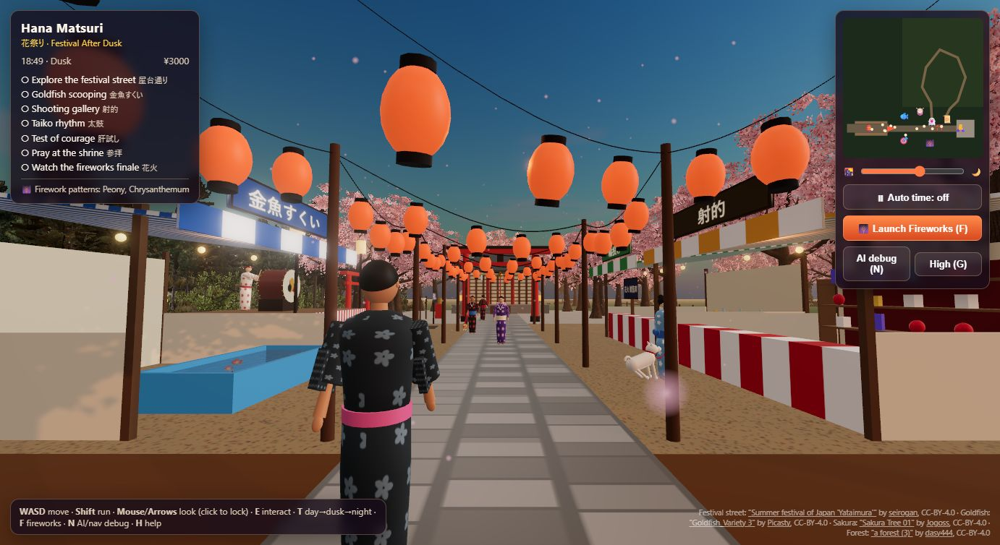

> **CS549 — Artificial Intelligence for Visual Computing** (group project)
> Shweatha Bathina Mallikarjuna (sb2808, group leader) · Chiranjeevi Bhuvaneshwari Pamarthy (cp1270) ·
> Jayanth Jayaram Jayakumar Naidu (jj1112) · Prithvi Govindareddy (pg708) · Mentor: Danrui Li

---

## Contents

1. [The idea](#the-idea)
2. [Assignment 3 MVP: Goldfish Scooping](#assignment-3-mvp-goldfish-scooping-kingyo-sukui)
3. [The festival world](#the-festival-world)
4. [Graphics pillars and where they live in the code](#graphics-pillars-and-where-they-live-in-the-code)
5. [Architecture](#architecture)
6. [Controls](#controls)
7. [Build and run](#build-and-run)
8. [Performance work](#performance-work)
9. [Asset pipeline](#asset-pipeline)
10. [Project timeline](#project-timeline)
11. [Use of AI](#use-of-ai)
12. [Roadmap to the final](#roadmap-to-the-final)
13. [Credits](#credits)

---

## The idea

Hana Matsuri is a festival experience where the graphics techniques *are* the gameplay. Instead of separate tech demos,
lighting, animation, physics, collision, navigation and NPC behaviour all run together in one explorable place:

- The same street changes from **afternoon → dusk → night**: sky, sun and moon, fog, emissive lanterns and bloom.
- **Festival games** are built on real algorithms: a wave simulation in the goldfish tub, ballistic corks in the shooting gallery, a rhythm game driven by the audio clock.
- **Visitors** walk between stalls with A* pathfinding and decide what to do with behaviour trees.
- The night ends with **real-time particle fireworks** whose patterns depend on what the player completed.

| Afternoon | Night |
|---|---|
| 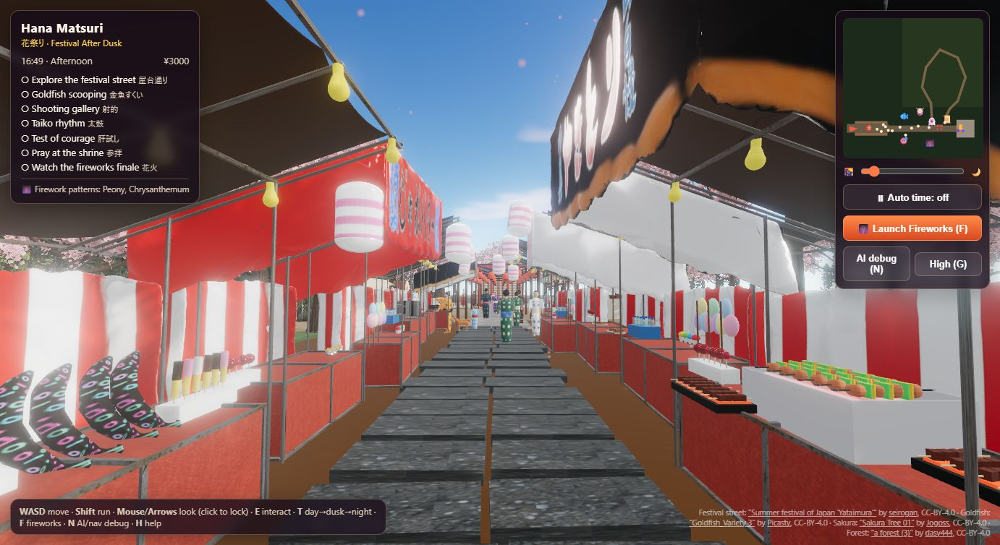 | 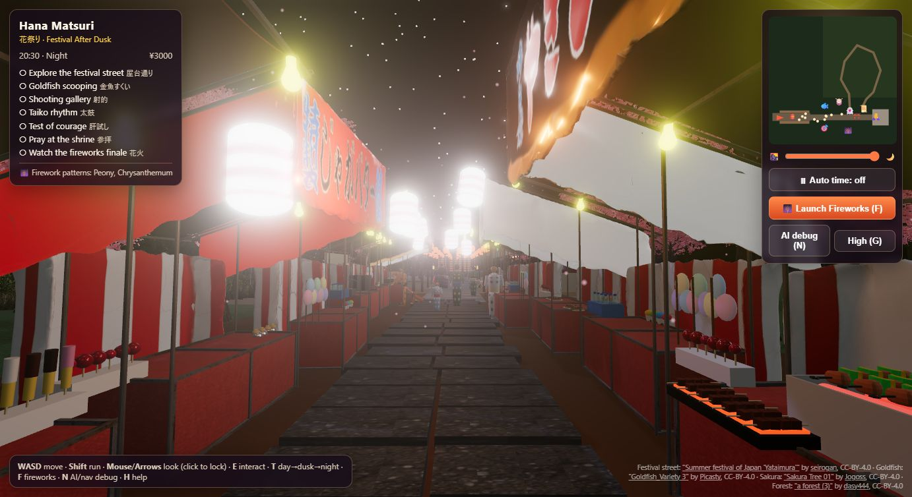 |

---

## Assignment 3 MVP: Goldfish Scooping (Kingyo-sukui)

The narrow vertical slice defined in Assignment 2, implemented in [`src/games/goldfish.js`](src/games/goldfish.js).

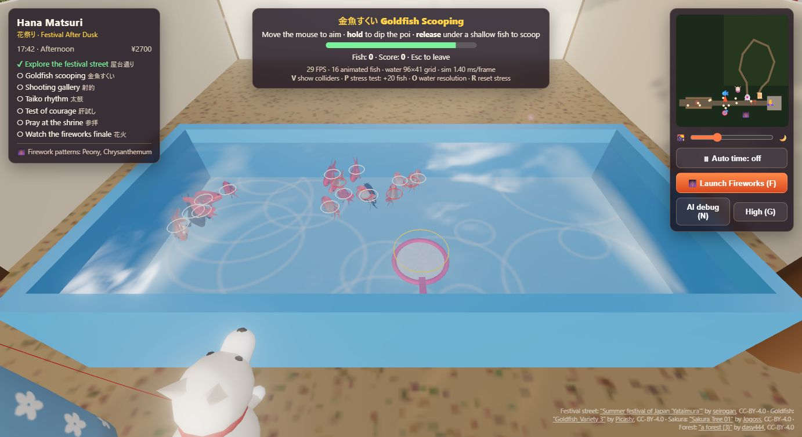

**Success test (works in one continuous session):** walk to the stall → press **E** → control the paper scoop (poi) →
the water reacts → catch a moving fish → yen reward, prize and objective marked complete → back to the festival.

| System | How it works |
|---|---|
| **Animated fish** | A rigged goldfish glTF (8 animation clips) is cloned per fish with `SkeletonUtils`. Each fish has its own `AnimationMixer`; `Swim_Slow` and `Swim_fast` are blended by swim speed, and `jump` plays when a fish is scooped into the bowl. |
| **Fish behaviour** | Boids: separation, alignment and cohesion, plus tub-wall avoidance and a flee force from the submerged poi (stronger when the poi moves fast). Fish drift between surface and bottom and dive when frightened. |
| **Water** | Height-field simulation: the discrete 2D wave equation on a 96×41 grid (`h' = (sum of 4 neighbours)/2 − h_prev`, then damping), stepped at a fixed 60 Hz with reflecting borders. Dipping, dragging and lifting the poi, splashes and shallow-swimming fish disturb it. Normals and crest colours are rebuilt every step. |
| **Collision** | A fish is caught only if its body circle overlaps the paper disc **and** it is above the paper's depth when the poi is lifted. Paper strength drops with water drag (poi speed) and fish weight; the paper visibly tears. |
| **Debug view (V)** | Draws the catch radius and every fish's hit circle: green = catchable, white = shallow, red = too deep. |
| **Stress test** | Live HUD readout of FPS, fish count, grid size and simulation time. **P** adds 20 animated fish (up to 600), **O** raises the water grid (64 → 384 cells wide), **R** resets. |

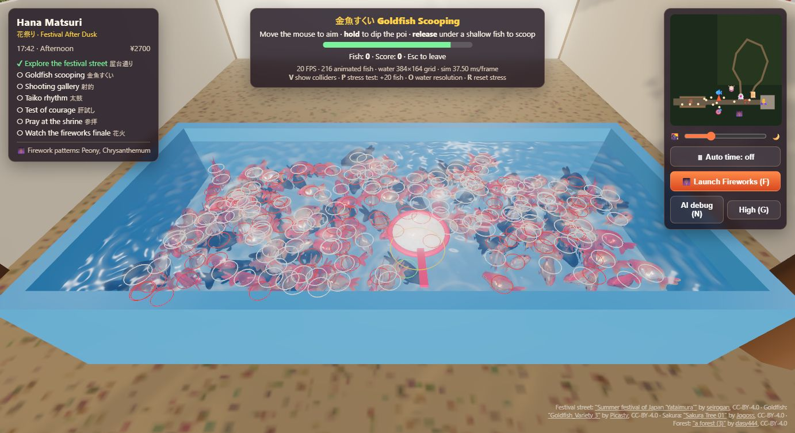

| Measured (Chrome, desktop) | Fish | Water grid | Water sim | FPS |
|---|---|---|---|---|
| Normal play | 16 | 96 × 41 | ≈1.3 ms/frame | 60 |
| Stress test | 216 | 384 × 164 | ≈14 ms/frame | ≈31 |

The stress-test costs are skinned-mesh animation (one mixer per fish) and the CPU wave simulation, which grows with grid cells.

---

## The festival world

| | |
|---|---|
| 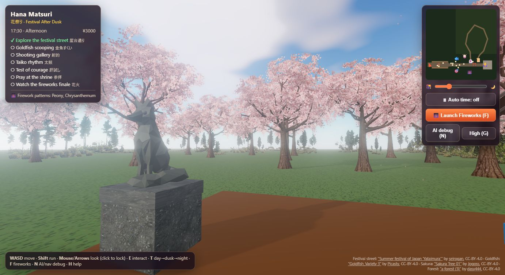 | 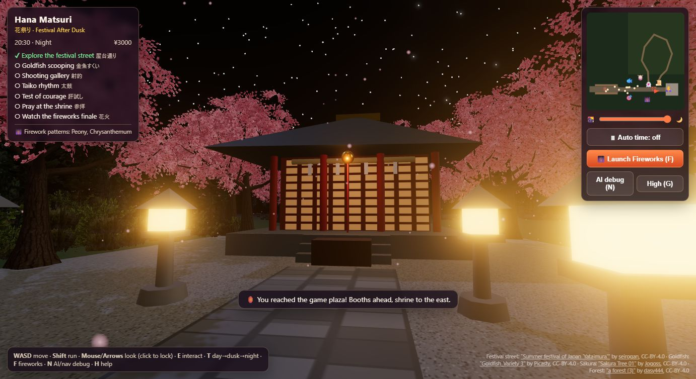 |
| **Cherry-blossom grove**: instanced trees that sway in the wind. | **Shrine at night**: stone lanterns, bell, offering box and omikuji. |
| 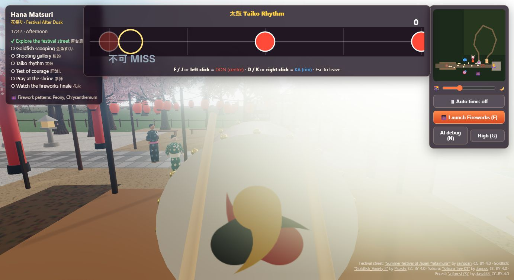 | 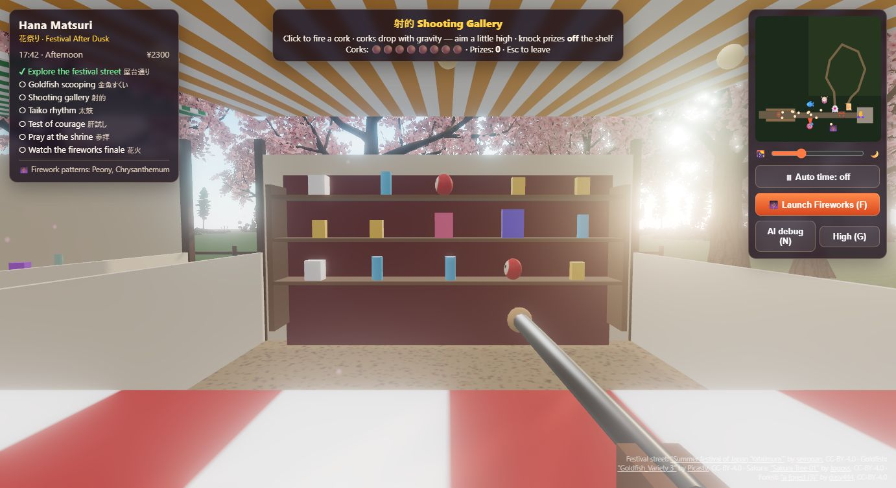 |
| **Taiko rhythm game**: notes timed from the Web Audio clock. | **Shooting gallery (shateki)**: cork ballistics and toppling prizes. |
| 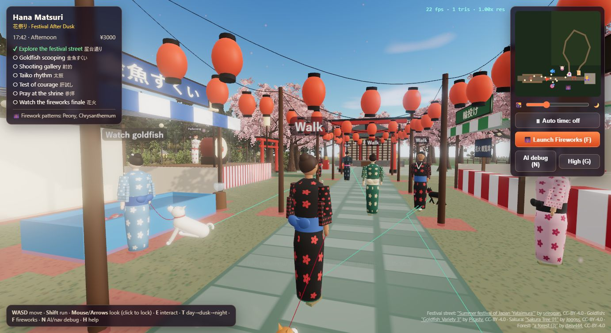 | 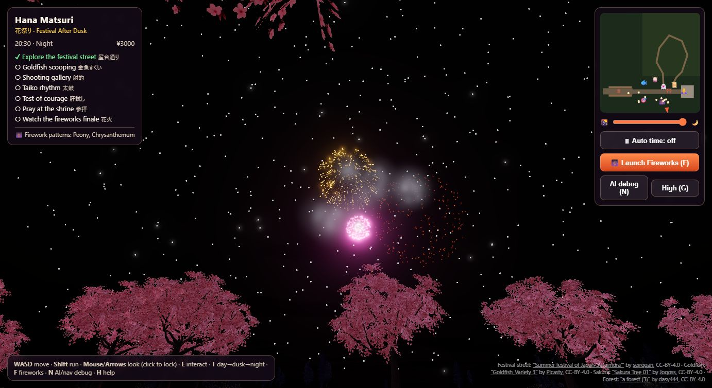 |
| **AI debug view (N)**: each visitor's active behaviour-tree node, A* paths and the navigation grid. | **Fireworks finale**: CPU-integrated particles with gravity, drag, trails and splitting stars. |

What's in the world:

- **Festival street:** a Sketchfab street of food stalls, with food on every counter (takoyaki, yakitori on a glowing grill, choco bananas, jaga-butter, okonomiyaki, oden, ramune, candy apples, cotton candy, shaved ice) and stall owners who greet the player.
- **Game plaza:** goldfish scooping, shooting gallery, ring-toss prizes and a taiko stage with an animated drummer.
- **Shrine district:** torii gate, shrine with bell and prayer, omikuji fortunes and stone lanterns.
- **Kimodameshi (test of courage):** a dark forest loop with fog, a hand lantern, courage seals to collect, ghost scares and will-o'-wisps.
- **Visitors:** procedural yukata-clad visitors (one skinned mesh each), some walking leashed dogs with a four-legged trot gait.
- **Atmosphere:** cherry blossoms and a conifer forest swaying in the wind, falling petals, and synthesised audio (cicadas by day, crickets at night, crowd murmur, drums, bell, fireworks).
- **Progression:** HUD objectives, minimap, in-game yen, and firework patterns unlocked by completed activities.

---

## Graphics pillars and where they live in the code

| Pillar | What we implemented | Code |
|---|---|---|
| **Rendering** | Day→night transition (Sky shader, sun/moon directional light with shadows, hemisphere light, fog, tone-mapping exposure, emissive lanterns, bloom); lantern light pool; GPU wind in vertex shaders | [`world.js`](src/world.js), [`sakura.js`](src/sakura.js), [`forest.js`](src/forest.js), [`main.js`](src/main.js) |
| **Animation** | Skeletal goldfish clips and blending; procedural NPC walk, idle, wave, cheer, pray, bow and drum poses; dog trot gait; bell swing; lantern sway; taiko sticks | [`goldfish.js`](src/games/goldfish.js), [`npc.js`](src/npc.js), [`pets.js`](src/pets.js) |
| **Physics & dynamics** | Height-field water; cork ballistics with gravity and drag; momentum-based prize toppling; fireworks particles (launch velocity, gravity, drag, fading, trails, splitting); wind on decorations and trees | [`goldfish.js`](src/games/goldfish.js), [`shateki.js`](src/games/shateki.js), [`fireworks.js`](src/fireworks.js) |
| **Collision detection** | Fish–poi circle + depth test; sphere vs. AABB for corks and prizes; circle vs. box and circle world for the player, NPCs and dogs | [`collision.js`](src/collision.js), [`goldfish.js`](src/games/goldfish.js), [`shateki.js`](src/games/shateki.js) |
| **Pathfinding & navigation** | Obstacles rasterised into a grid; A* with an octile heuristic; line-of-sight path smoothing; local separation steering | [`nav.js`](src/nav.js), [`npc.js`](src/npc.js) |
| **NPC AI / behaviour trees** | Behaviour-tree runtime (Selector, Sequence, reactive Guard, Action). Visitors watch fireworks, gather at the taiko stage, greet the player, choose stalls and interact. Stall owners use an idle / interact / response state machine; crowds react to events | [`npc.js`](src/npc.js) |

---

## Architecture

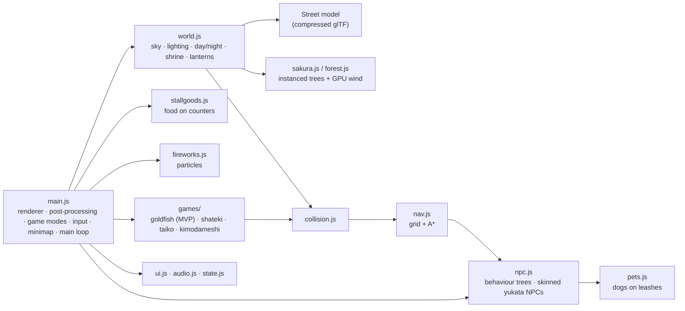

```
index.html               HUD, menus, styles
src/main.js              renderer, bloom, game modes, input, minimap, main loop
src/world.js             environment, day/night lighting, shrine, lanterns, trees
src/layout.js            world layout: positions, bounds, stalls
src/player.js            first-person controller
src/collision.js         2D collision world (boxes + circles), sphere-vs-box
src/nav.js               grid navigation, A*, path smoothing
src/npc.js               behaviour trees, skinned yukata characters, owners, drummer
src/pets.js              dogs with gait animation and leashes
src/stallgoods.js        food and goods on the stall counters
src/sakura.js            instanced cherry trees + vertex-shader wind
src/forest.js            photo-card forest trees rebuilt from a glTF scene
src/fireworks.js         particle fireworks
src/games/goldfish.js    MVP: goldfish scooping, boids, height-field water
src/games/shateki.js     shooting gallery
src/games/taiko.js       taiko rhythm game
src/games/kimodameshi.js haunted forest path
src/audio.js             synthesised Web Audio sound
src/island.js            draft island + reflective water environment (next milestone)
public/models/           compressed glTF assets
report/                  Assignment 3 report (PDF + source)
docs/screenshots/        screenshots used in this README
```

---

## Controls

| Key | Action |
|---|---|
| **W A S D** | Walk · **Shift** run |
| **Mouse** (click to lock) / **arrow keys** | Look around |
| **E** | Interact: stalls, games, shrine, omikuji, fireworks |
| **T** | Afternoon → dusk → night |
| **F** | Launch the fireworks finale |
| **N** | AI debug view: behaviour-tree nodes, A* paths, nav grid, FPS |
| **G** | Toggle graphics quality |
| **H** | Help |
| **Esc** | Leave a minigame |

In goldfish scooping: **mouse** aims, **hold/release** dips/lifts the poi, **V** shows colliders, **P / O / R** run the stress test.
In taiko: **F/J** or left click = DON, **D/K** or right click = KA.

---

## Build and run

Requires **Node.js 18+**.

```bash
git clone https://github.com/Shwethabathina/hana-matsuri.git
cd hana-matsuri
npm install
npm run dev        # http://localhost:5173
```

Production build and preview:

```bash
npm run build      # outputs dist/
npm run preview    # serves dist/ at http://localhost:4173
```

**Deploy:** `dist/` is a static site. We deploy it to Vercel (`npx vercel deploy --prod` from a folder containing the build).
All asset paths are relative (`vite.config.js` sets `base: './'`), so any static host works.

---

## Performance work

Adding the forest and cherry grove made the game stutter, so we profiled triangles, draw calls and CPU time per system, then:

- **Street model:** simplified from **804k to 188k triangles** with meshoptimizer (welding, then aggressive simplification of the light bulbs). Two dense foliage clumps were replaced by cherry trees.
- **Instanced trees:** grouped into 40 m blocks with bounding spheres for frustum culling, plus distance culling beyond the haze.
- **Lighting:** a **light pool**: only the 4 lanterns nearest the player are real point lights (6 lights in total instead of 14).
- **Foliage shading:** Lambert shading on overlapping foliage cards (overdraw), and conifers kept out of the shadow map.
- **Characters:** one skinned mesh (2 draw calls) per NPC instead of about 13 meshes.
- **Goldfish tub:** the water simulates at half rate unless the game is being played.

**Result:** about **6.3M → 1.3–1.9M triangles per frame**. Some optimisations made the experience worse and were reverted
after playtesting: adaptive resolution made the image blurry, and throttled shadow updates caused judder.

---

## Asset pipeline

Sketchfab models are compressed with [gltf-transform](https://gltf-transform.dev) before use:

| Asset | Original | Shipped | Processing |
|---|---|---|---|
| Festival street | 97 MB · 804k tris | 15 MB · 188k tris | weld, simplify, quantize, WebP textures, split into small buffers |
| Goldfish (rigged, 8 clips) | 12.3 MB | 3.5 MB | texture resize + WebP |
| Sakura tree | 5.1 MB · 7k tris | 0.7 MB · 3.3k tris | WebP, bark simplified |
| Forest scene | 29 MB | 1.8 MB | meshopt + WebP; trees rebuilt at load from trunk + photo cards |

---

## Project timeline

| Assignment | Outcome |
|---|---|
| **1: Group formation, pillars, concept** | Chose six pillars: rendering, animation, physics, collision, pathfinding, NPC behaviour trees. Wrote the concept (afternoon-to-night festival, four main activities, fireworks finale) and made AI mockups. |
| **2: Approval, specs and MVP** | Approved, with Danrui Li as mentor. Wrote the PRD and tech spec (Three.js + Vite, no runtime AI dependency) and defined the MVP: Goldfish Scooping with responsive water. |
| **3: MVP implementation** | Goldfish scooping with skeletal fish, boids, height-field water, readable collision, reward loop and stress test. Plus scene polish and a performance pass. Report in [`report/`](report/). |
| **Final** | See the roadmap below. |

---

## Use of AI

- **Claude Code** wrote first versions of large systems (boids, height-field water, behaviour trees, A*, fireworks), built the asset-compression pipeline, and used a headless browser to screenshot the game, catch runtime errors and profile frame cost.
- **ChatGPT** helped with debugging, Three.js API questions and shader/particle ideas.
- **AI image generation** was used only for the concept mockups in Assignment 1.
- **All 3D assets** in the build are CC-BY Sketchfab models (credited below) or procedural geometry. None are AI-generated.
- **No runtime AI API** is used, so the build is predictable and works offline.
- **Every AI-produced change was checked in the running game.** Several were tuned or reverted after playtesting: lighting, compression settings and some performance fixes.

---

## Roadmap to the final

- **Main activities:** polish the shooting gallery and taiko game, and finish kimodameshi.
- **Characters:** rigged human models (walk/idle blending) for visitors, keeping the behaviour-tree AI.
- **Environment:** island setting with reflective water, cliffs and a raised shrine terrace (drafted in [`src/island.js`](src/island.js)).
- **Trees:** denser near the festival using impostors / LOD.
- **Shorter interactions:** ring toss, yo-yo fishing, mask memory, Daruma balancing and a lantern puzzle (scope permitting).
- **Finale:** fireworks that reflect more of the player's progress.
- **Low-end laptops:** GPU water and instanced fish.

---

## Credits

3D models (all CC-BY-4.0, used with attribution):

- Festival street: ["Summer festival of Japan 'Yataimura'"](https://sketchfab.com/3d-models/summer-festival-of-japan-yataimura-f68b39782b0e45a18c8d4f6c45831576) by [seirogan](https://sketchfab.com/seirogan)
- Goldfish: ["Goldfish_Variety 3"](https://sketchfab.com/3d-models/goldfish-variety-3-851c92634c014949ae78c4b52807584f) by [Picasty](https://sketchfab.com/picasty)
- Cherry trees: ["Sakura Tree 01 - Low Poly Model"](https://sketchfab.com/3d-models/sakura-tree-01-low-poly-model-147ae7d0d332456a99ec6195e9b0cd4f) by [Jogoss](https://sketchfab.com/thejogoss9)
- Forest trees: ["a forest (3) with a road at night for game"](https://sketchfab.com/3d-models/a-forest-3-with-a-road-at-night-for-game-61f8c7817fe6457fb26e4814cfc48a3f) by [dasy444](https://sketchfab.com/dasy444)

Libraries: [three.js](https://threejs.org), [Vite](https://vitejs.dev), [gltf-transform](https://gltf-transform.dev), [meshoptimizer](https://github.com/zeux/meshoptimizer).
