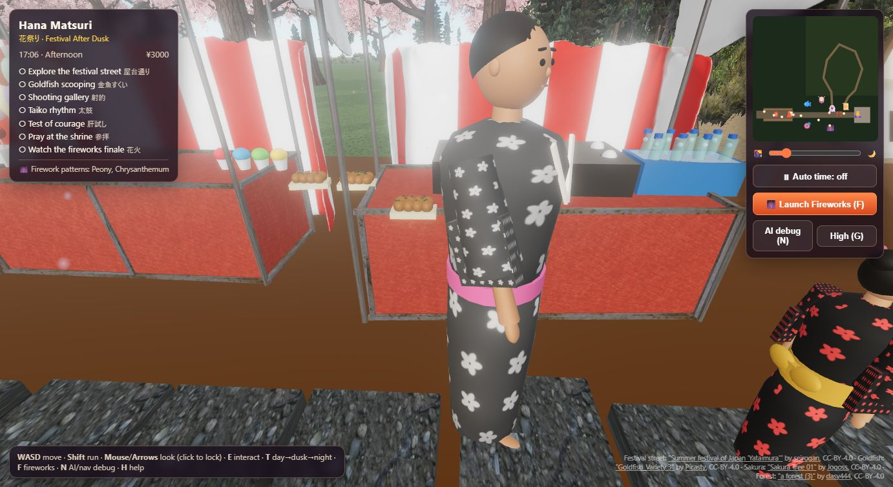
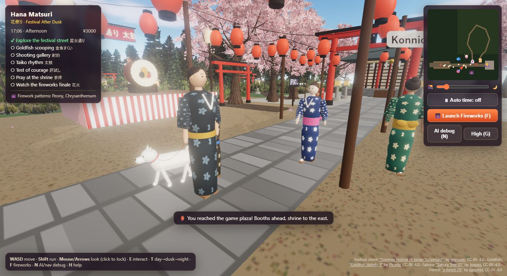
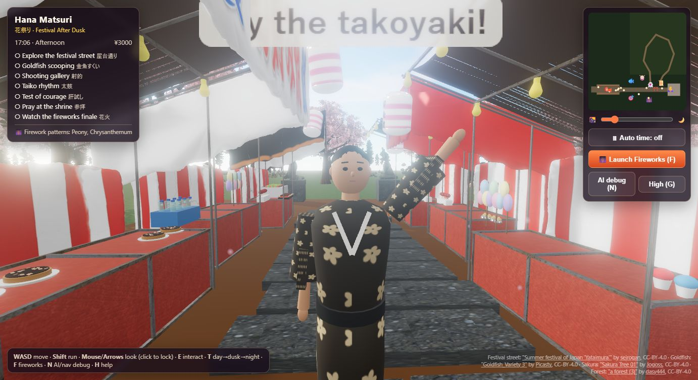
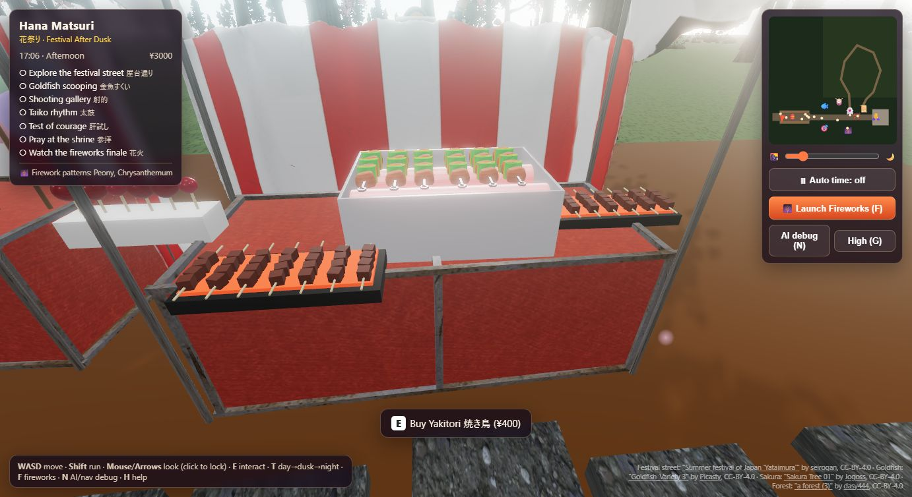

# Hana Matsuri — Festival After Dusk 花祭り

An interactive, real-time Japanese summer festival in the browser, built with **Three.js / WebGL**.
Stroll a lantern-lit street of food stalls under swaying cherry blossoms, play festival games, meet visitors
and their dogs, watch the afternoon turn into night, and end the evening with a fireworks finale.

**▶ Play it live: https://hana-matsuri.vercel.app** · Desktop Chrome or Edge recommended


> A group project for **CS549 — Artificial Intelligence for Visual Computing**.
> Shweatha Bathina Mallikarjuna · Chiranjeevi Bhuvaneshwari Pamarthy · Jayanth Jayaram Jayakumar Naidu · Prithvi Govindareddy
> Mentor: Danrui Li

---

## Contents

1. [Highlights](#highlights)
2. [Afternoon to night](#afternoon-to-night)
3. [Festival stalls and food](#festival-stalls-and-food)
4. [Visitors, stall owners and pets](#visitors-stall-owners-and-pets)
5. [Cherry blossoms and forest](#cherry-blossoms-and-forest)
6. [Festival games and activities](#festival-games-and-activities)
7. [Fireworks finale](#fireworks-finale)
8. [Graphics pillars in the code](#graphics-pillars-in-the-code)
9. [Architecture](#architecture)
10. [Controls](#controls)
11. [Build and run](#build-and-run)
12. [Performance](#performance)
13. [Asset pipeline](#asset-pipeline)
14. [Development milestones](#development-milestones)
15. [Use of AI](#use-of-ai)
16. [Roadmap](#roadmap)
17. [Credits](#credits)

---

## Highlights

| | | |
|---|---|---|
|  |  |  |
| **Afternoon → night** lighting on the same street | **Lanterns** take over after dark | **Food on every stall** counter |
|  |  |  |
| **Visitors walking dogs** on leashes | **Yukata-clad visitors** with faces and gestures | **Cherry blossoms** swaying in the wind |
|  |  |  |
| **Goldfish scooping** with live water | **Taiko** rhythm game | **Fireworks** finale |

---

## Afternoon to night

The player arrives in the late afternoon. Over a few minutes (or instantly with **T**) the same festival becomes dusk, then night:

- **Sky and sun:** a physical sky with the sun setting and the moon and stars rising; the sun and moon light cast shadows.
- **Atmosphere:** sky light, fog colour and density, and exposure all follow the time of day.
- **Lanterns:** the paper lanterns, stall signs and bulbs glow more and more, and bloom fades in after sunset.
- **Lantern light pool:** only the 4 lanterns nearest the player are real lights, which keeps the night scene fast.
- **Sound:** cicadas by day give way to crickets at night.

| Dusk at the plaza | Shrine at night |
|---|---|
|  |  |

---

## Festival stalls and food

Every stall counter in the street is stocked. The code finds each counter top by reading the vertices of the street model's table
meshes, so the items sit exactly on the model ([`src/stallgoods.js`](src/stallgoods.js)). What each stall sells matches its sign:

| Stall | On the counter |
|---|---|
| Yakitori | Skewers on a glowing charcoal grill |
| Takoyaki | Paper boats of takoyaki balls with seaweed flakes |
| Choco banana | Chocolate- and pink-dipped bananas in a foam block |
| Jaga-butter | Potatoes in foil with butter |
| Okonomiyaki | Pancakes on plates with sauce and bonito flakes |
| Oden | A pot with eggs and radish |
| Other stalls | Ramune bottles on ice, candy apples, cotton-candy bags, shaved ice with syrups |

Stall owners in hachimaki headbands work their stalls, greet the player and bow when you buy something (**E**).
Food is bought with in-game yen. The game plaza adds a goldfish booth, a shooting gallery, a ring-toss prize shelf and a taiko stage.



---

## Visitors, stall owners and pets


**Visitors** ([`src/npc.js`](src/npc.js)) are procedural people in yukata:
- **Looks:** each visitor has a crossed collar, wide sleeves and an obi (women's have a bow on the back), and a face with eyes, brows, nose and mouth. Hairstyles include buns with kanzashi hair ornaments, longer hair and short men's cuts. Heights vary, and some visitors are children.
- **Cheap to draw:** each person is **one skinned mesh** (two draw calls), with bones for the torso, head, arms and feet.
- **Animation:** walking with counter-rotating shoulders, idling, eating, watching, cheering, waving, praying and bowing. Poses blend smoothly between states.

**Behaviour:**
- **Behaviour trees:** each visitor chooses, in priority order:
  1. go to the fireworks viewing area when the show starts
  2. gather at the taiko stage while someone is playing
  3. greet the player when they come close
  4. otherwise pick a stall or sight, walk there and do something (eat, pray, look at the goldfish)
- **Navigation:** visitors walk with **A\*** on a grid built from the world's colliders, with path smoothing, and steer around each other and the player.
- **Reactions:** nearby visitors cheer at festival events, such as a prize won or a firework burst.
- **Stall owners** use a small state machine (idle → greet → thank). A **drummer** performs on the taiko stage.

**Dogs** ([`src/pets.js`](src/pets.js)):
- **Breeds:** four visitors walk dogs: a shiba, a black shiba, an Akita and a corgi.
- **Gait:** they trot with diagonal leg pairs, and the stride speeds up with their pace.
- **Behaviour:** they wag their tails, sniff the ground and sit when their owner stops. They also keep a little distance from the player.
- **Leash:** a red leash runs from the owner's hand to the collar and sags when it goes slack.

**AI debug view (N):** shows each visitor's active behaviour-tree node, their A* paths, the navigation grid and the FPS.


---

## Cherry blossoms and forest


- **Cherry blossom grove:** surrounds the festival, from a low-poly sakura model ([`src/sakura.js`](src/sakura.js)).
- **Haunted forest and far woods:** conifers rebuilt at load time from a photo-card forest scene ([`src/forest.js`](src/forest.js)). Each tree is a bark trunk plus its branch cards.
- **Wind in the vertex shader:** every tree sways on the GPU. The bend grows with height so trunks stay planted, gusts push whole crowns, blossoms flutter, and each tree has its own phase so the grove never moves in lockstep.
- **Petals and lanterns:** sakura petals drift down over the festival, and lantern strings swing in the same wind.
- **Cheap to draw:** trees are instanced in 40 m blocks with frustum and distance culling.

---

## Festival games and activities

### Goldfish scooping (kingyo-sukui)

The deepest system in the project ([`src/games/goldfish.js`](src/games/goldfish.js)).


| System | How it works |
|---|---|
| **Animated fish** | A rigged goldfish model (8 animation clips) is cloned per fish, each with its own `AnimationMixer`. Slow and fast swim cycles blend by speed, and a jump plays when a fish is scooped into the bowl. |
| **Schooling** | Boids (separation, alignment, cohesion), wall avoidance and fleeing from the paper scoop (poi). Fish drift between surface and bottom and dive when frightened. |
| **Water** | A height-field simulation: the discrete 2D wave equation on a grid, stepped at a fixed 60 Hz with damping and reflecting walls. The poi, splashes and shallow fish make ripples that spread and bounce off the tub. |
| **Collision** | A fish is scooped only if its body circle overlaps the paper **and** it swims above the paper's depth when lifted. Water drag and fish weight weaken the paper until it tears. **V** shows the circles. |
| **Reward** | Yen, a goldfish prize, the objective ticked off, and a new firework pattern. |
| **Stress test** | **P** adds 20 fish, **O** raises the water resolution, and a live readout shows FPS and simulation cost. |

### More to do

| Activity | What it is |
|---|---|
| **Shooting gallery (shateki)** | Cork-gun ballistics with gravity and drag. Prizes wobble or topple depending on where the cork hits and how heavy they are. |
| **Taiko rhythm game** | Notes timed from the Web Audio clock (DON and KA). The drummer steps aside, visitors gather, and they cheer as your combo grows. |
| **Kimodameshi (test of courage)** | A dark forest loop with fog and a hand lantern. Collect five courage seals while ghosts glide past, lights flicker and will-o'-wisps circle. |
| **Shrine** | Ring the bell and pray, draw an omikuji fortune, then tie it to the rack. |
| **Food stalls** | Buy food from the owners with yen. |


---

## Fireworks finale


A real-time particle system ([`src/fireworks.js`](src/fireworks.js)):
- **Shells:** rockets launch with a computed velocity, leave spark trails and burst at the top of their flight.
- **Physics:** stars fall under gravity and air drag and fade from their colour to embers. Crossette stars split in four, and willows hang and drift.
- **Light and smoke:** each burst briefly lights the festival below, and smoke puffs drift away.
- **Patterns:** they depend on what the player completed: goldfish glitter, taiko double rings, shooting-gallery crossettes, ghost willows from kimodameshi, and sakura bursts from the shrine.
- **Crowd:** visitors walk to the viewing area to watch.

---

## Graphics pillars in the code

| Pillar | What we implemented | Code |
|---|---|---|
| **Rendering** | Day→night transition (sky, sun/moon shadows, hemisphere light, fog, exposure, emissive lanterns, bloom); lantern light pool; GPU wind shaders; instanced, culled trees | [`world.js`](src/world.js), [`sakura.js`](src/sakura.js), [`forest.js`](src/forest.js), [`main.js`](src/main.js) |
| **Animation** | Skeletal goldfish clips with blending; skinned NPCs with procedural poses; dog trot gait; bell, lantern and tree sway; taiko sticks | [`goldfish.js`](src/games/goldfish.js), [`npc.js`](src/npc.js), [`pets.js`](src/pets.js) |
| **Physics & dynamics** | Height-field water; cork ballistics; momentum-based prize toppling; firework particles with gravity, drag, fading, trails and splitting; wind | [`goldfish.js`](src/games/goldfish.js), [`shateki.js`](src/games/shateki.js), [`fireworks.js`](src/fireworks.js) |
| **Collision detection** | Fish–poi circle + depth test; sphere vs. box for corks and prizes; a circle/box world for the player, visitors and dogs | [`collision.js`](src/collision.js), [`goldfish.js`](src/games/goldfish.js), [`shateki.js`](src/games/shateki.js) |
| **Pathfinding & navigation** | Grid built from colliders, A* with an octile heuristic, line-of-sight smoothing, separation steering | [`nav.js`](src/nav.js), [`npc.js`](src/npc.js) |
| **NPC AI / behaviour trees** | Behaviour-tree runtime (Selector, Sequence, reactive Guard, Action) for visitors; state machines for stall owners; crowd reactions | [`npc.js`](src/npc.js) |

---

## Architecture


```
index.html               HUD, menus, styles
src/main.js              renderer, bloom, game modes, input, minimap, main loop
src/world.js             environment, day/night lighting, shrine, lanterns, trees
src/layout.js            world layout: positions, bounds, stalls
src/player.js            first-person controller
src/collision.js         2D collision world (boxes + circles), sphere-vs-box
src/nav.js               grid navigation, A*, path smoothing
src/npc.js               behaviour trees, skinned yukata visitors, stall owners, drummer
src/pets.js              dogs with gait animation and leashes
src/stallgoods.js        food and goods on the stall counters
src/sakura.js            instanced cherry trees + vertex-shader wind
src/forest.js            photo-card forest trees rebuilt from a glTF scene
src/fireworks.js         particle fireworks
src/games/goldfish.js    goldfish scooping: skeletal fish, boids, height-field water
src/games/shateki.js     shooting gallery
src/games/taiko.js       taiko rhythm game
src/games/kimodameshi.js haunted forest path
src/audio.js             synthesised Web Audio sound
src/island.js            draft island + reflective water environment (planned)
public/models/           compressed glTF assets
docs/screenshots/        screenshots used in this README
```

---

## Controls

| Key | Action |
|---|---|
| **W A S D** | Walk · **Shift** run |
| **Mouse** (click to lock) / **arrow keys** | Look around |
| **E** | Interact: stalls, games, shrine, omikuji, fireworks |
| **T** | Afternoon → dusk → night |
| **F** | Launch the fireworks finale |
| **N** | AI debug view: behaviour-tree nodes, A* paths, nav grid, FPS |
| **G** | Toggle graphics quality |
| **H** | Help |
| **Esc** | Leave a minigame |

Goldfish scooping: **mouse** aims, **hold/release** dips/lifts the poi, **V** collision circles, **P / O / R** stress test.
Taiko: **F/J** or left click = DON, **D/K** or right click = KA.

---

## Build and run

Requires **Node.js 18+**.

```bash
git clone https://github.com/Shwethabathina/hana-matsuri.git
cd hana-matsuri
npm install
npm run dev        # http://localhost:5173
```

Production build:

```bash
npm run build      # outputs dist/
npm run preview    # serves dist/ at http://localhost:4173
```

`dist/` is a static site with relative asset paths (`vite.config.js` sets `base: './'`), so any static host works. We deploy to Vercel.

---

## Performance

We profiled triangles, draw calls and CPU time per system, and tuned the scene to stay smooth:

- **Street model:** simplified from **804k to 188k triangles** with meshoptimizer.
- **Trees:** instanced in 40 m blocks with frustum and distance culling, with Lambert shading on overlapping foliage cards. Conifers are kept out of the shadow map.
- **Lights:** a pool of the **4 nearest lantern lights** instead of 14 point lights.
- **People:** one skinned mesh per person (2 draw calls instead of ~13).
- **Goldfish tub:** the water simulates at half rate unless the game is being played.

**Result:** about **6.3M → 1.3–1.9M triangles per frame**. In goldfish scooping, normal play (16 fish, 96×41 water grid) runs at
60 FPS with the water simulation at ≈1.3 ms. The stress test (216 fish, 384×164 grid) holds ≈31 FPS.

---

## Asset pipeline

Sketchfab models are compressed with [gltf-transform](https://gltf-transform.dev) and meshoptimizer before use:

| Asset | Original | Shipped | Processing |
|---|---|---|---|
| Festival street | 97 MB · 804k tris | 15 MB · 188k tris | weld, simplify, quantize, WebP textures, split into small buffers |
| Goldfish (rigged, 8 clips) | 12.3 MB | 3.5 MB | texture resize + WebP |
| Sakura tree | 5.1 MB · 7k tris | 0.7 MB · 3.3k tris | WebP, bark simplified |
| Forest scene | 29 MB | 1.8 MB | meshopt + WebP; trees rebuilt at load from trunk + photo cards |

---

## Development milestones

1. **Concept:** chose six graphics pillars (rendering, animation, physics, collision, pathfinding, NPC behaviour trees) and the festival concept, with AI-generated mockups as visual references.
2. **Specification:** project approved, with Danrui Li as mentor. Wrote the product requirements and tech spec (Three.js + Vite, no runtime AI dependency) and chose goldfish scooping with responsive water as the first vertical slice.
3. **Vertical slice:** goldfish scooping with skeletal fish, boids, height-field water, readable collision, a reward loop and a stress test.
4. **World polish:** food on every stall, visitors rebuilt as skinned yukata characters, dogs on leashes, the cherry-blossom grove and forest with wind, and a performance pass.
5. **Next:** see the [roadmap](#roadmap).

---

## Use of AI

- **Claude Code** wrote first versions of large systems (boids, height-field water, behaviour trees, A*, fireworks), built the asset-compression pipeline, and used a headless browser to screenshot the game, catch runtime errors and profile frame cost.
- **ChatGPT** helped with debugging, Three.js API questions and shader/particle ideas.
- **AI image generation** was used only for early concept mockups.
- **All 3D assets** in the build are CC-BY Sketchfab models (credited below) or procedural geometry. None are AI-generated.
- **No runtime AI API** is used, so the game is predictable and works offline.
- **Every AI-produced change was checked in the running game.** Several were tuned or reverted after playtesting: lighting, compression settings and some performance fixes.

---

## Roadmap

- **Main activities:** polish the shooting gallery and taiko game, and finish kimodameshi.
- **Characters:** rigged human models (walk/idle blending) for visitors, keeping the behaviour-tree AI.
- **Environment:** island setting with reflective water, cliffs and a raised shrine terrace (drafted in [`src/island.js`](src/island.js)).
- **Trees:** denser near the festival using impostors / LOD.
- **More activities:** ring toss, yo-yo fishing, mask memory, Daruma balancing, lantern puzzle.
- **Finale:** fireworks that respond to more of the player's progress.
- **Low-end laptops:** GPU water and instanced fish.

---

## Credits

3D models (all CC-BY-4.0, used with attribution):

- Festival street: ["Summer festival of Japan 'Yataimura'"](https://sketchfab.com/3d-models/summer-festival-of-japan-yataimura-f68b39782b0e45a18c8d4f6c45831576) by [seirogan](https://sketchfab.com/seirogan)
- Goldfish: ["Goldfish_Variety 3"](https://sketchfab.com/3d-models/goldfish-variety-3-851c92634c014949ae78c4b52807584f) by [Picasty](https://sketchfab.com/picasty)
- Cherry trees: ["Sakura Tree 01 - Low Poly Model"](https://sketchfab.com/3d-models/sakura-tree-01-low-poly-model-147ae7d0d332456a99ec6195e9b0cd4f) by [Jogoss](https://sketchfab.com/thejogoss9)
- Forest trees: ["a forest (3) with a road at night for game"](https://sketchfab.com/3d-models/a-forest-3-with-a-road-at-night-for-game-61f8c7817fe6457fb26e4814cfc48a3f) by [dasy444](https://sketchfab.com/dasy444)

Libraries: [three.js](https://threejs.org), [Vite](https://vitejs.dev), [gltf-transform](https://gltf-transform.dev), [meshoptimizer](https://github.com/zeux/meshoptimizer).
